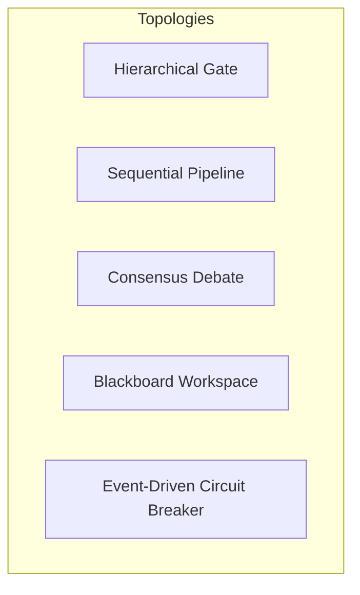

# Architecture & Coordination Protocols

> Technical reference for multi-agent bot swarms, team topologies, communication protocols, and execution lifecycles.

---

## 1. Multi-Agent Topologies

Choosing the correct topology determines how information flows between bots, how decisions are validated, and how infinite loops or deadlocks are prevented.



### 1.1. Hierarchical Gate (`hierarchical_gate`)
- **Structure**: A lead supervisor / architect decomposes incoming goals into a directed acyclic graph (DAG) of atomic tasks, delegates tasks to specialist workers, and passes results through an adversarial QA gate.
- **Strength**: High fidelity and adherence to technical requirements; strict quality control.
- **Failure Mode**: Supervisor bottleneck; worker idle time if tasks are strictly sequential.
- **Used In**: [Autonomous Software Engineering Squad](../templates/software-engineering-squad.md).

### 1.2. Sequential Pipeline (`pipeline`)
- **Structure**: Output of Bot $A$ becomes direct input to Bot $B$, which flows into Bot $C$, with optional back-propagation loops for editorial review.
- **Strength**: Maximum throughput for predictable, step-wise transformations (e.g., trend scan $\to$ draft $\to$ visual asset $\to$ publication).
- **Failure Mode**: Cascading errors if an early bot introduces an undetected hallucination.
- **Used In**: [Growth & Content Studio Swarm](../templates/growth-content-studio.md).

### 1.3. Multi-Model Consensus Debate (`consensus_debate`)
- **Structure**: Multiple heterogeneous foundation models (e.g., DeepSeek-R1 for formal derivation, Claude 3.7 for systems engineering, Grok 3 for adversarial attack) independently generate proposals, perform round-robin peer review, and hand over to an impartial Arbiter.
- **Strength**: Eliminates single-model reasoning bias, reveals hidden blind spots, and drastically reduces hallucinations.
- **Failure Mode**: High token consumption; risk of endless circular disagreements without an authoritative arbiter.
- **Used In**: [Multi-Model Consensus & Debate Pod](../templates/multi-model-debate-pod.md).

### 1.4. Blackboard Shared Workspace (`blackboard`)
- **Structure**: Agents do not message each other directly; instead, they inspect and mutate a shared durable memory store (database, vector store, or markdown notebook).
- **Strength**: Highly decoupled, asynchronous, and scalable to dozens of parallel micro-agents.
- **Failure Mode**: Race conditions and contradictory state updates without transactional locks.
- **Used In**: Large-scale open-ended research cells and autonomous company runtimes.

### 1.5. Stream Circuit Breaker (`stream_circuit_breaker`)
- **Structure**: Ingest bots consume continuous telemetry (on-chain mempools, server logs, API metrics). When anomaly classifiers detect a threat above threshold, emergency actions or human alerts trigger instantly.
- **Strength**: Sub-second response times for security defense and financial risk containment.
- **Failure Mode**: False positives causing unnecessary service interruptions.
- **Used In**: [Autonomous Web3 & Risk Sentinel](../templates/web3-risk-sentinel.md).

---

## 2. Communication Protocols & Formats

To ensure bots from different platforms can interoperate seamlessly, the following protocols are supported:

| Protocol | Layer | Best Used For | Message Schema |
|:---|:---|:---|:---|
| **Model Context Protocol (MCP)** | Tool & Context Interop | Connecting bots to external files, DBs, terminals, and third-party APIs. | JSON-RPC 2.0 |
| **Agent-to-Agent (A2A)** | Inter-Agent Direct Messaging | Exchanging task specifications, feedback diffs, and delegation requests. | Structured JSONL / Event envelopes |
| **Server-Sent Events (SSE)** | Live Observability | Streaming bot reasoning tokens and tool calls to web cockpits & TUIs. | Text stream (`data: {...}`) |
| **WebSockets** | Low-Latency Telemetry | Real-time audio streaming, collaborative canvas sync, and mempool feeds. | Binary / JSON frame |

---

## 3. Standard Agent-to-Agent Message Envelope

When agents transmit structured messages across network boundaries or process queues, messages adhere to the canonical envelope format:

```json
{
  "trace_id": "trace_9f8e7d6c5b4a",
  "source_agent": "architect",
  "target_agent": "implementer",
  "timestamp": "2026-10-31T17:30:00Z",
  "intent": "TASK_DELEGATION",
  "payload": {
    "task_id": "TASK-102",
    "title": "Implement rate limiting middleware",
    "constraints": [
      "Use Redis token bucket algorithm",
      "Reject requests exceeding 100 req/min with HTTP 429",
      "Include Retry-After header in response"
    ],
    "context_files": [
      "src/server.ts",
      "src/middleware/auth.ts"
    ]
  },
  "governance": {
    "max_steps": 12,
    "budget_usd": 0.25,
    "human_review_required": false
  }
}
```

---

## 4. Loop Prevention & Deadlock Mitigation

In autonomous swarms, recursive calls or circular debates can lead to runaway API bills. Every team template enforces:

1. **Step Governor (Turn Ceiling)**: Every task execution carries an integer counter incremented per model turn. If `turn >= max_steps` (default: 15), execution halts with status `STATUS_STEP_LIMIT_EXCEEDED` and raises a human escalation event.
2. **Deterministic Handoff Tokens**: Handshakes between roles require explicit completion tokens (`PASS`, `REJECT: <reason>`, `DISPATCH: <target>`). Free-form conversational filler is suppressed.
3. **Blacklist for Stale Diffs**: If an implementer bot produces an identical failing diff twice in succession, the supervisor intervenes to re-frame the problem or request human guidance.
