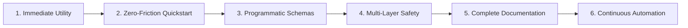

# High-Level Production Quality Standard for AI & Agent Repositories

> **Standard Identifier**: `STD-REPO-PROD-2026.1`  
> **Status**: Canonical / Enforced  
> **Target**: Public & Enterprise AI Repositories, Multi-Agent Swarms, and Awesome Lists.

This document formalizes the production-grade repository architecture and release criteria designed to match top-tier, trending open-source projects on GitHub. Any project adhering to this standard delivers immediate developer utility, robust reproducibility, cryptographic safety, and sustainable community governance.

---

## 1. Core Architectural Pillars

A production-grade repository must satisfy the **Six Pillars of Open-Source Excellence**:



1. **Immediate Developer Utility**: The repository must not be a mere index of external links; it must provide executable primitives, templates, configurations, or runnable code that can be adopted within 60 seconds.
2. **Zero-Friction Quickstart**: A developer must be able to clone and verify repository functionality with zero external dependencies (pure standard library where possible) or single-command installation.
3. **Programmatic & Machine-Readable**: Declarative assets (such as agent teams, bot topologies, tool bindings) must exist as both human-readable Markdown and machine-readable YAML/JSON schemas.
4. **Multi-Layer Safety & Governance**: Systems capable of autonomous tool execution must explicitly mandate turn limits, cost governors, sandboxing boundaries, and human-in-the-loop checkpoints.
5. **Complete Documentation Suite**: Architecture, CLI manuals, template contribution standards, and security policies must be modularized under `docs/` rather than cluttering the root README.
6. **Continuous Automation**: Every commit and pull request must be validated through automated CI checking syntax, link health, schema validity, and execution tests.

---

## 2. Mandatory Repository File Structure

Every repository following this standard must implement the following filesystem layout:

```
├── .github/
│   ├── ISSUE_TEMPLATE/
│   │   ├── config.yml              # Issue template chooser configuration
│   │   ├── bug_report.yml          # Structured bug report schema
│   │   ├── feature_request.yml     # Structured feature proposal schema
│   │   └── new_team_template.yml   # Template contribution intake form
│   ├── PULL_REQUEST_TEMPLATE.md    # Quality checklist for pull requests
│   ├── SECURITY.md                 # Vulnerability disclosure policy & SLA
│   └── workflows/
│       ├── lint.yml                # Automated schema, syntax, and CLI test gate
│       └── awesome-lint.yml        # Repository health & link integrity checks
├── docs/
│   ├── ARCHITECTURE.md             # Topology, message flows, and protocol deep dive
│   ├── CLI_REFERENCE.md            # Command-line manual and argument specifications
│   ├── TEMPLATE_GUIDELINES.md      # Authoring guidelines for community contributions
│   ├── SAFETY_AND_GOVERNANCE.md    # Execution safety limits, circuit breakers, sandboxing
│   └── PRODUCTION_STANDARD.md      # This specification standard
├── templates/
│   ├── schemas/                    # Declarative YAML/JSON definitions for all templates
│   │   └── *.yaml
│   └── *.md                        # Deep human-readable specs with Mermaid diagrams
├── .gitignore                      # Exhaustive OS, editor, and runtime ignore patterns
├── CITATION.cff                    # Standard citation metadata for research/academic papers
├── CODE_OF_CONDUCT.md              # Contributor Covenant v2.1
├── CONTRIBUTING.md                 # Contribution criteria, style guide, and workflow
├── LICENSE                         # Permissive or public domain license (CC0 / Apache 2.0 / MIT)
├── README.md                       # High-aesthetic hero, badges, TOC, quickstart, catalog, tables
└── <entrypoint_cli>                # Zero-dependency bootstrap tool (e.g., init-team.py)
```

---

## 3. README Quality Benchmark

A trending-tier README must strictly follow this visual and informational hierarchy:

1. **Hero Title & Badge Array**:
   - Clean SVG badges: Awesome list verification, GitHub stars, GitHub forks, license, CI workflow status, PRs welcome, and Python/runtime versions.
2. **Elevator Pitch (Blockquote)**:
   - A single, unambiguous sentence defining what the project provides and who it serves.
3. **Table of Contents (Jump Links)**:
   - Synchronized links to all top-level sections and templates.
4. **30-Second Quickstart**:
   - A self-contained code snippet showing how to clone, inspect, and run or export assets immediately.
5. **Categorized Curated Catalog**:
   - Distinct sections organized logically, with bold project titles, canonical links, and 1–2 sentence descriptions focusing on architectural differentiators.
6. **Interactive / Executable Features**:
   - Code block demonstrations showing CLI commands and their exact expected terminal output.
7. **Comparison Matrix / Topology Guide**:
   - Markdown tables comparing runtimes, interaction topologies, and use cases.
8. **Community & Star History**:
   - Clear contribution links, code of conduct references, license details, and star history visualizations.

---

## 4. Multi-Agent & Bot Team Specification Rules

When modeling teams of bots, agents, or automated actors:

1. **Explicit Role Boundaries**: Every role must define:
   - `id`: Lowercase alphanumeric identifier.
   - `title`: Professional human-readable role name.
   - `goal`: Concrete, non-overlapping objective.
   - `system_prompt`: Explicit behavioral directives and operational guardrails.
   - `tools`: Whitelist of necessary tools/capabilities.
2. **Topology Declaration**: Every team must explicitly state its coordination pattern:
   - `hierarchical_gate`: Supervisor breaks down tasks and enforces quality gates.
   - `pipeline`: Sequential data transformation passing through review stages.
   - `consensus_debate`: Multi-model cross-critique ending in neutral arbiter synthesis.
   - `fan_out_synthesis`: Parallel harvesters aggregated by an adversarial verifier.
   - `stream_circuit_breaker`: Continuous event listener triggering automated mitigation.
   - `triage_pod`: Tier-based front-line sorting with human escalation fallback.
3. **Mermaid Flowchart**: Every team specification must include an inline `mermaid` flowchart diagram illustrating message propagation and error/rejection loops.

---

## 5. Security & Safety Gates

Any repository containing autonomous tooling must enforce:

- **Turn Governors**: Max turns capped at 15–25 turns per invocation.
- **Budget Caps**: Dollar / token limits per task with circuit breakers.
- **Dry-Run Defaults**: CLI tools and execution scripts must default to simulation/preview mode before mutating local or remote resources.
- **Sanitized Prompts**: Avoid committing raw API keys, production tokens, or unredacted personal identifiers.

---

## 6. Verification & Release Checklist

Before tagging a version or announcing a public release:

- [ ] All YAML schemas pass strict validation via `init-team.py --validate`.
- [ ] Automated CI workflows in `.github/workflows/` execute cleanly on Linux and macOS.
- [ ] All Markdown links in `README.md` and `docs/` resolve correctly.
- [ ] Git commit history adheres to Conventional Commits (`feat:`, `fix:`, `docs:`, `chore:`).
- [ ] Public license is properly declared in `LICENSE` and linked across the README.
