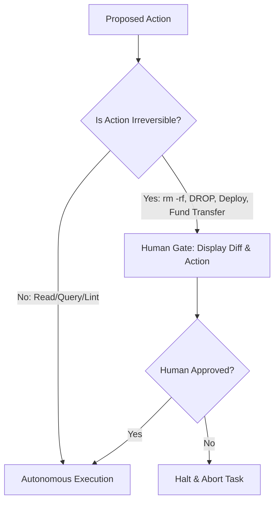

# Safety Brakes & Multi-Agent Governance

> Operational safeguards, execution boundaries, cost governors, and human-in-the-loop protocols for autonomous bot squads.

---

## 1. The Autonomous Hazard Matrix

Multi-agent swarms introduce compound risks that do not exist in single-turn LLM completions:

| Risk Category | Hazard Vector | Autonomous Impact | Mitigation Mechanism |
|:---|:---|:---|:---|
| **Recursive Runaways** | Infinite delegation loops between bots | Astronomical token consumption & API billing exhaustion | Max Turn Governor (Hard ceiling at 15–20 turns) |
| **Silent Drifts** | Repeated minor errors compounded across pipeline | Garbage output masquerading as completed work | Adversarial QA Gates with deterministic criteria |
| **Irreversible Side-Effects** | Autonomous execution of destructive commands | Data loss, accidental PR merges, unwanted email blasts | Human-in-the-Loop Confirmation Gates |
| **Cascading Injection** | Untrusted external input injected into worker tool call | Subversion of downstream agents in the swarm | Input sanitization & context isolation envelopes |
| **Agent Hijacking** | Malicious bot node impersonating swarm leader | Rogue system instruction broadcast | Signed message digests & token authentication |

---

## 2. Hard Execution Ceilings (Step Governors)

Every agent harness or orchestration script must implement a deterministic turn limiter:

```python
MAX_STEPS = 15

def execute_swarm_loop(task, agents):
    step_count = 0
    while not task.is_resolved():
        step_count += 1
        if step_count > MAX_STEPS:
            trigger_emergency_halt(
                reason=f"Execution exceeded hard ceiling of {MAX_STEPS} steps.",
                task=task
            )
            return ExecutionResult(status="HALTED_STEP_LIMIT_EXCEEDED")
        dispatch_next_turn(task, agents)
```

---

## 3. Financial Cost & Token Circuit Breakers

To protect developer and enterprise infrastructure from runaway spend:

1. **Per-Task Dollar Cap**: Cap individual tasks to a strict maximum (e.g., `$0.50` for standard code tasks, `$2.00` for deep research).
2. **Cumulative Run Quota**: Set process-level limits across the entire session. If the token counter exceeds the quota, all outbound model calls return `429 TokenBudgetExceeded` and preserve state to disk.
3. **Model Tier Downshifting**: Automatically downshift from frontier models (e.g., Claude 3.7 Sonnet / GPT-4o) to lightweight models (e.g., Gemini 2.5 Flash / Qwen 2.5 Coder 32B) for intermediate reasoning steps.

---

## 4. Human-in-the-Loop Confirmation Gates

Never grant agents unconditional authority to execute irreversible external mutations. The following actions **require explicit, cryptographic human approval**:



- Filesystem: Recursive deletes (`rm -rf`), writes outside the designated workspace sandbox.
- Database: `DROP TABLE`, `TRUNCATE`, bulk `UPDATE`/`DELETE` without specific primary keys.
- Infrastructure: Cloud resource deprovisioning (`gcloud projects delete`, AWS teardown).
- External Channels: Public social media posts, outbound email sends, payment transfers.

---

## 5. Ephemeral Sandbox Isolation

Agents executing arbitrary code or compiling untrusted dependencies must run inside isolated micro-environments:

- **Docker Containers**: Disposable containers with non-root users, restricted memory (`--memory 2g`), and read-only host filesystem mounts.
- **MicroVMs (Firecracker / Fly Sprites)**: Hardware-virtualized sandboxes providing total OS-level isolation for security fuzzing and penetration testing swarms.
- **Network Egress Filtering**: Restrict outbound network access strictly to verified endpoints (package registries, target API endpoints). Block access to internal metadata IP addresses (`169.254.169.254`).

---

## 6. Dead Man's Switch & Heartbeat Protocols

For long-running background teams (e.g., continuous mempool watchers or nightly CI triage bots):

- **Heartbeat Emitting**: The supervisor bot emits a signed heartbeat event every 60 seconds.
- **Fail-Safe Disarm**: If the human operator or parent orchestration process fails to acknowledge heartbeats within 3 consecutive intervals, the bot swarm enters a dormant pause state, safely committing its active state to a local journal.
