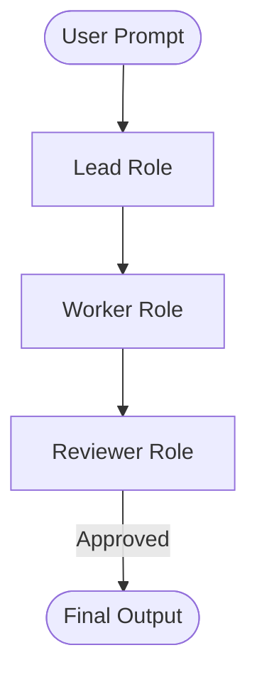

# Template Authoring Guidelines

> Guide for creating, testing, and contributing new bot squad blueprints and execution schemas.

---

## 1. Overview

Each bot team blueprint in Awesome Bot Teams consists of two complementary artifacts:

1. **Human-Readable Specification** (`templates/<team-id>.md`): A comprehensive document outlining team purpose, role rosters, inputs/outputs, Mermaid interaction flowcharts, and system prompt seeds.
2. **Machine-Readable YAML Schema** (`templates/schemas/<team-id>.yaml`): A declarative schema ingested by `init-team.py` to generate framework-native code (CrewAI, AutoGen, LangGraph, etc.).

---

## 2. Markdown Specification Template

Create your markdown file in `templates/<your-team-id>.md` using this standard layout:

```markdown
# Template: [Team Name]

> **Topology**: [Topology Pattern Name]  
> **Ideal For**: [Summary of 2-4 target use cases]

---

## 1. Roster & Roles

| Role | Responsibility | Input | Output | Tools / Permissions |
|------|---------------|-------|--------|---------------------|
| **[Role Name 1]** | [Primary responsibility] | [Input artifact] | [Output artifact] | [Tools needed] |
| **[Role Name 2]** | [Primary responsibility] | [Input artifact] | [Output artifact] | [Tools needed] |

---

## 2. Interaction Flow



---

## 3. Initiation System Prompts

### Role 1: [Role Name]
```markdown
[Concrete, non-conversational behavioral directives]
```

### Role 2: [Role Name]
```markdown
[Concrete, non-conversational behavioral directives]
```
```

---

## 3. Schema Authoring Guidelines

1. Place the YAML file in `templates/schemas/<your-team-id>.yaml`.
2. Ensure the filename matches `team.id` exactly.
3. Every role must specify `id`, `title`, `goal`, and `system_prompt`.
4. Run the validation suite before submitting:
   ```bash
   python3 init-team.py --validate
   ```

---

## 4. Quality Checklist Before Submitting a PR

- [ ] Filenames use lowercase hyphenated format (`my-team-pod.md` and `my-team-pod.yaml`).
- [ ] Mermaid diagram syntax renders without errors in GitHub preview.
- [ ] System prompt seeds include explicit boundary constraints (what the bot should *not* do).
- [ ] `init-team.py --template <your-team-id> --export crewai` generates valid Python code.
- [ ] Entry added to the table in `README.md` with links to both the spec and YAML schema.
