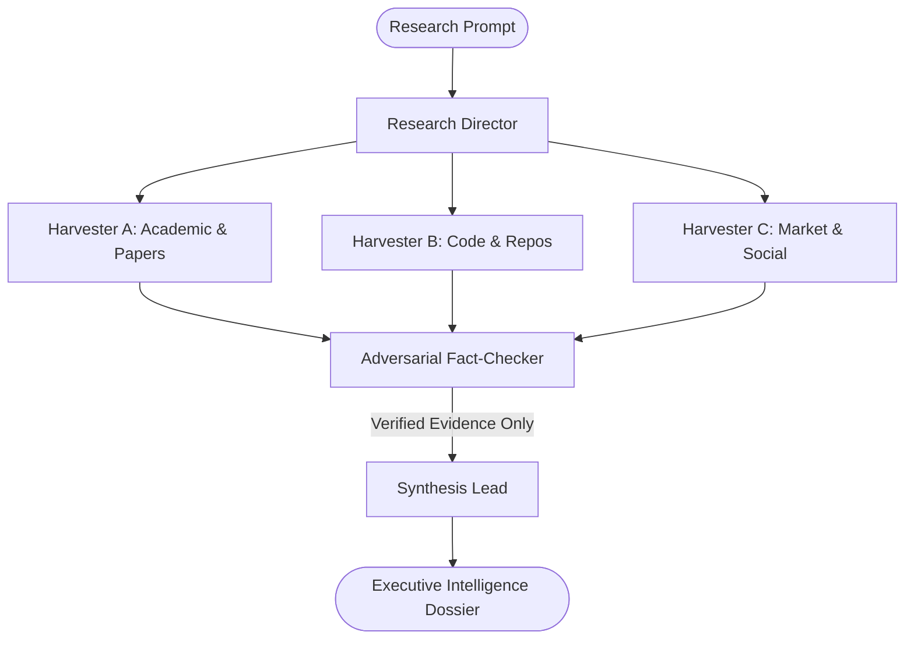

# Template: Deep Research & Intelligence Cell

> **Topology**: Parallel Scrapers + Adversarial Fact-Checker + Synthesis Lead  
> **Ideal For**: Market intelligence, academic literature surveys, protocol audits, competitive deep dives, and white paper drafting.

---

## 1. Roster & Roles

| Role | Responsibility | Input | Output | Tools / Permissions |
|------|---------------|-------|--------|---------------------|
| **Research Director** | Clarifies the research hypothesis, identifies search vectors, partitions inquiries. | Primary inquiry / topic | Research matrix & targeted questions | Planning engine |
| **Field Harvesters (Parallel)** | Query academic papers, github repos, regulatory filings, and primary web sources. | Query cluster | Raw excerpts with canonical URLs | Web retrieval, PDF parser, repo scraper |
| **Adversarial Fact-Checker** | Validates claims against primary sources, identifies hallucinations, checks methodology flaws. | Extracted findings & source links | Verification scorecard & flagged doubts | Cross-checking search, Wayback machine |
| **Synthesis & Report Author** | Synthesizes verified claims into structured executive summaries, dossiers, and citation bibliographies. | Verified findings | Comprehensive report with KaTeX / charts | Document generator, markdown exporter |

---

## 2. Interaction Flow

