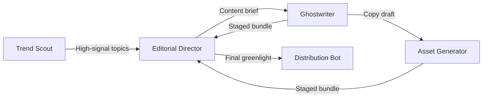

# Template: Growth & Content Studio Swarm

> **Topology**: Pipeline with Peer Review Feedback Loop  
> **Ideal For**: Multi-channel social strategy, technical blogs, newsletter generation, viral hook testing, and multimedia staging.

---

## 1. Roster & Roles

| Role | Responsibility | Input | Output | Tools / Permissions |
|------|---------------|-------|--------|---------------------|
| **Trend & Signal Scout** | Scans feeds (X/Twitter, Reddit, Hacker News, Arxiv) for emerging narratives and audience sentiment. | Keyword list, RSS, social APIs | Trend briefing & angle recommendations | Social read APIs, Web search, RSS fetcher |
| **Editorial Director** | Determines content calendar, brand voice adherence, and storyline arcs. Selects winning angles. | Trend briefing | Content briefs & tone guidelines | Content management system, docs |
| **Ghostwriter / Copy Engine** | Drafts long-form essays, tweet/X threads, LinkedIn posts, and newsletter digests. | Content brief & target audience | Draft copy with variations | Markdown editor, character/length validator |
| **Media & Asset Generator** | Generates companion visuals, infographics prompts, thumbnails, or code snippet cards. | Copy draft & key visual hook | Image assets, SVG cards, meme templates | Image gen APIs, canvas/card renderer |
| **Distribution & Scheduler** | Formats posts per platform, schedules releases, tracks engagement metrics. | Approved copy & visual assets | Scheduled queue & analytics report | Social post scheduling APIs |

---

## 2. Interaction Flow

