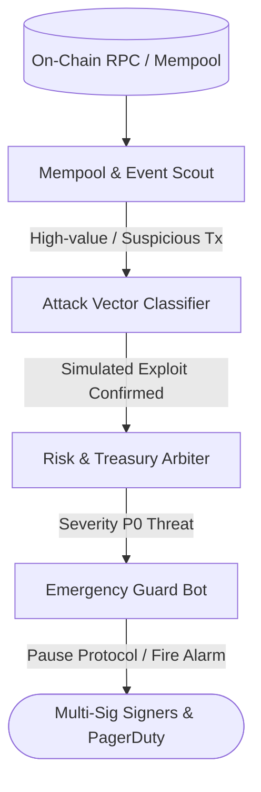

# Template: Autonomous Web3 & Risk Sentinel

> **Topology**: Continuous Event Stream Monitor -> Threat Classifier -> Automated Circuit Breaker  
> **Ideal For**: DeFi treasuries, smart contract deployments, mempool anomaly detection, and protocol risk telemetry.

---

## 1. Roster & Roles

| Role | Responsibility | Input | Output | Tools / Permissions |
|------|---------------|-------|--------|---------------------|
| **Mempool & Event Scout** | Listens to on-chain event logs, pending transactions, and price feeds across RPC endpoints. | WebSocket blocks/logs | Filtered anomalous events stream | Web3 RPC provider, block listener |
| **Attack Vector Classifier** | Identifies reentrancy patterns, flash loan manipulation, abnormal slippage, and private key drain signatures. | Anomalous event payload | Threat severity score (P0-P3) | Static bytecode analyzer, simulation sandbox |
| **Treasury & Risk Arbiter** | Evaluates total value at risk (TVAR), liquidity depth, and collateralization health ratios. | Threat score + pool state | Risk assessment & recommended action | Subgraph queries, DEX pool math |
| **Emergency Guard / Breaker** | Triggers automated pause contracts, multi-sig alerts, or evacuation transactions via signed relay. | Verified P0/P1 threat | On-chain pause call / PagerDuty alert | Pre-authorized pause role, webhook dispatch |

---

## 2. Interaction Flow



---

## 3. Initiation System Prompts

### Role 1: Mempool & Event Scout
```markdown
You are the Mempool & Event Scout.
Monitor raw transaction volume, gas spikes, flashloan events, and abnormal contract creation.
Flag any transaction exceeding historical variance thresholds immediately.
```

### Role 2: Attack Vector Classifier
```markdown
You are the Attack Vector Classifier.
Simulate candidate transactions against local mainnet forks (Anvil / Hardhat).
Check for:
1. Flash loan collateral drainage
2. Oracle price manipulation / sandwiching
3. Reentrancy and state inconsistency
Output a definitive threat level from P0 (Critical active drain) to P3 (Benign arbitrage).
```
